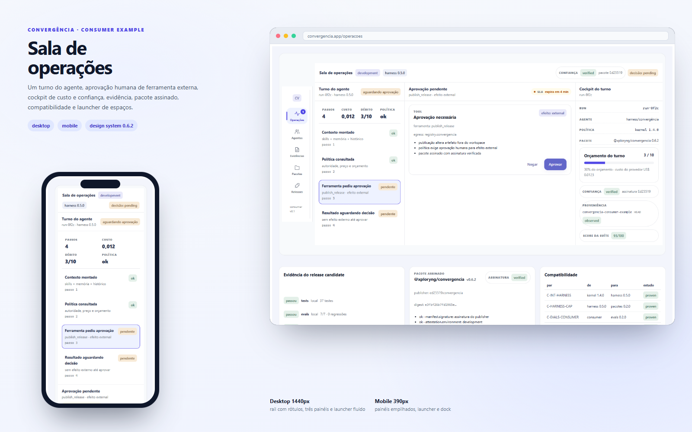

# Convergência Design System

A linguagem visual comum: tokens, componentes e blocos para as superfícies da Convergência.

[Plano de controle](https://github.com/xploryngDAO/convergencia-kit) · [BOM](https://github.com/xploryngDAO/convergencia-kit/blob/main/convergencia.bom.json) · [Contrato para agentes](AGENTS.md) · [Padrão de documentação](https://github.com/xploryngDAO/convergencia-docs)

## Interface



O design system em uso real: rail com rótulos, painéis, launcher fluido e a mesma navegação no celular.

<sub>Composição real do build 0.6.3 — desktop 1440px e mobile 390px.</sub>

### Storybook


<sub>Storybook de tokens: cores semânticas, tipografia, estados e fundações.</sub>

## O que é

O Design System reúne a identidade visual do ecossistema: cores, tipografia, espaçamento, componentes e blocos prontos para as telas de produto.

Ele é a referência para que Personia, SuperJarvis, apps e próximos projetos pareçam ter vindo do mesmo lugar.

## Por que existe

- 101 tokens com fonte única;
- 60 componentes tipados;
- 19 blocos de domínio para aprovação, custo, confiança, evidência, pacote e superfícies;
- tema claro e escuro, acessibilidade e testes.

## Como começar

```bash
npm install https://github.com/xploryngDAO/convergencia-design-system/releases/download/v0.6.3/xploryng-convergencia-0.6.3.tgz
npm run build
npm test
npm run storybook
```

## O que tem dentro

- tokens para web e nativo;
- átomos, campos, navegação, feedback e padrões;
- blocos de domínio registrados para agentes;
- Storybook e exemplos de adoção.

## Storybook

O catálogo está publicado como artefato da release `v0.6.3`
(`storybook-static-0.6.3.zip`). Baixe, extraia e sirva localmente; a hospedagem
pública foi desativada pela privatização do repositório.

## Como se conecta

É consumido pelas interfaces dos produtos e pelo console do consumidor de referência.

## Estado

- Truth class: `contract-spec`
- Versão: `0.6.3`
- Release: `v0.6.3` com digest verificado
- Realidade: publicado e privado
- Pendência: Storybook público desativado pela privatização; hospedar artefato interno.

## Licença

MIT.
