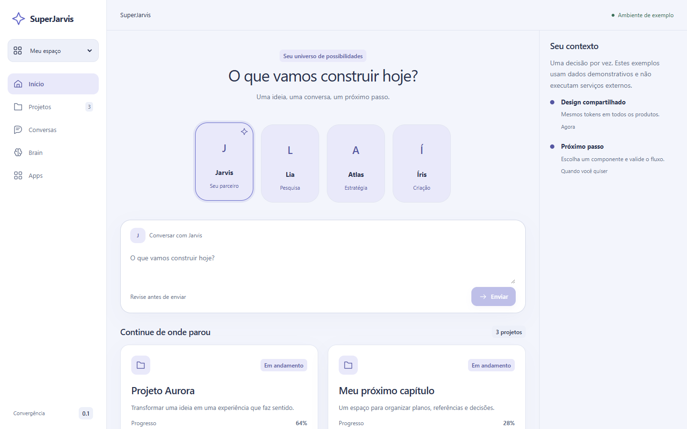

# Convergência Design System

A linguagem visual do **SuperJarvis**, organizada para ser compartilhada por produtos atuais e futuros. A referência é a visão Convergência: fundo frio, papel claro, índigo, tipografia de sistema, superfícies arredondadas, agentes contextualizados e continuidade entre desktop e celular.

[**Abrir o Storybook**](https://xploryngdao.github.io/convergencia-design-system/) · [Guia de adoção](docs/adoption.md) · [Contrato para agentes](AGENTS.md) · [Componentes](component-registry.json) · [Origem](docs/provenance.md)



## O que está incluído

- **101 tokens** com fonte JSON e geração de CSS, TypeScript e valores para plataformas nativas.
- **60 componentes** tipados, organizados em átomos, moléculas e organismos, com exemplos, propriedades e estados no Storybook.
- **5 blocos de domínio** da Convergência: `ApprovalGate`, `CostMeter`, `TrustBadge`, `ProvenanceTag` e `CompatMatrix`, exportados pela raiz do pacote.
- **7 templates**: início, projetos, conversa, materiais, Canvas, agenda e offline.
- **39 ícones SVG** extraídos da Convergência.
- Inventário pesquisável de **26 arquivos CSS / 8.848 regras / 72 condições responsivas**, com hashes e ordem da cascata.
- Tema claro e escuro, painéis inferiores no mobile, teclado, foco, redução de movimento e testes automatizados.
- CI, publicação do Storybook no GitHub Pages e pacote instalável por release.

O repositório é a fonte canônica da biblioteca. A Convergência original é a referência de procedência. O inventário registra toda a cascata, incluindo estilos específicos de produto; ele não significa que Brain, World ou um motor de Canvas foram transformados em serviços da biblioteca. [Escopo e cobertura](docs/coverage.md).

## Instalar em um produto React

```bash
npm install https://github.com/xploryngDAO/convergencia-design-system/releases/download/v0.1.0/xploryng-convergencia-0.1.0.tgz
```

A linha `0.2.x` adiciona os blocos de domínio e é consumida hoje pelo
`convergencia-consumer-example` via tarball vendorizado; a release pública
correspondente ainda não foi publicada.

```tsx
import { DesignSystemProvider, Button, Card, Heading } from '@xploryng/convergencia';
import '@xploryng/convergencia/styles.css';

export function App() {
  return (
    <DesignSystemProvider theme="light">
      <Card>
        <Heading level={1}>Meu próximo capítulo</Heading>
        <Button variant="primary" onClick={() => console.log('continuar')}>
          Continuar
        </Button>
      </Card>
    </DesignSystemProvider>
  );
}
```

O pacote é distribuído como artefato de GitHub Release; **não é necessário presumir publicação no registro npm**. Fixe a versão no lockfile. React e React DOM são peer dependencies. Os exemplos da documentação não conectam IA, autenticação ou armazenamento.

## HTML/CSS e outras plataformas

Use `tokens.css` e `styles.css` com classes `cv-*` dentro de `.cv-root`. O exemplo [HTML](examples/vanilla/index.html) funciona sem React para controles nativos. Comportamentos de menu, abas e modal exigem implementação acessível; as classes sozinhas não os implementam.

Para Expo/React Native, importe `nativeTokens` de `@xploryng/convergencia/native`. São **tokens**, não componentes nativos: fontes, safe areas, sombras, foco e navegação precisam das APIs da plataforma. [Guia de plataformas](docs/platforms.md).

## Blocos de domínio

Composições prontas para as superfícies da Convergência, sobre os átomos do
sistema:

- `ApprovalGate` — decisão humana com efeito, egress, razões e ações;
- `CostMeter` — débito/orçamento com barra acessível;
- `TrustBadge` — estado de confiança (verificado, recusado, desconhecido);
- `ProvenanceTag` — fonte, referência e classe de verdade;
- `CompatMatrix` — pares de compatibilidade e estado.

Os blocos não decidem política: exibem o que kernel, harness e kit já decidiram.
Uso de referência no console do `convergencia-consumer-example`.

## Executar o catálogo

Node 22.12+ e npm:

```bash
git clone https://github.com/xploryngDAO/convergencia-design-system.git
cd convergencia-design-system
npm ci
npm run storybook
```

Storybook: `http://127.0.0.1:6006`. Não requer credenciais, conta de IA, banco ou serviços pagos.

| Comando                           | Resultado                                               |
| --------------------------------- | ------------------------------------------------------- |
| `npm run tokens`                  | Gera CSS, TypeScript, valores nativos e aliases legados |
| `npm run typecheck`               | Verifica os tipos da biblioteca e dos exemplos          |
| `npm test`                        | Contratos de tokens, registro e distribuição            |
| `npm run build`                   | Biblioteca ESM e declarações TypeScript                 |
| `npm run build-storybook`         | Catálogo estático em `storybook-static/`                |
| `npx playwright install chromium` | Instala navegador dos testes                            |
| `npm run test:browser`            | Interações, acessibilidade e responsividade             |
| `npm run check`                   | Verificação completa                                    |
| `npm pack`                        | Artefato instalável                                     |

## Organização

```text
tokens/tokens.json           fonte única dos valores
src/                        componentes e CSS com escopo cv-
stories/components/         API, anatomia, teclado e estados por componente
stories/Templates*          composições interativas
component-registry.json     contrato legível por agentes
docs/                       fundações, adoção, cobertura, decisões, evidências
docs/reference/             inventário com origem e hashes
examples/                   adoção React, HTML e tokens nativos
scripts/                    geração, auditoria e registro de adoção
tests/                      contratos e testes em navegador
.github/workflows/          validação e publicação
```

## Adoção e contribuição

A adoção nos projetos atuais foi adiada pelo proprietário. Nenhuma aplicação existente é considerada migrada por esta publicação. Comece pelo [guia](docs/adoption.md) quando a migração for autorizada. Não copie a biblioteca para cada projeto: instale uma versão e atualize de forma controlada.

Leia [CONTRIBUTING.md](CONTRIBUTING.md), [AGENTS.md](AGENTS.md) e as [decisões](docs/decisions/0001-shared-system.md). Código sob MIT; fontes do sistema e imagens de agentes não são redistribuídas. [Avisos de terceiros](THIRD_PARTY_NOTICES.md).

## Documentation Reality Status

- Truth class: `contract-spec`
- Implementation status: `0.2.0-unreleased` (blocos de domínio; release pendente)
- Expectation status: `release line v0.1.0`; a linha 0.2.x ainda não tem release
- Reality status: `active-under-adoption`; o consumidor de referência usa tarball vendorizado
- Pending note: publicar release 0.2.0 e regenerar o Storybook quando o console estabilizar.

